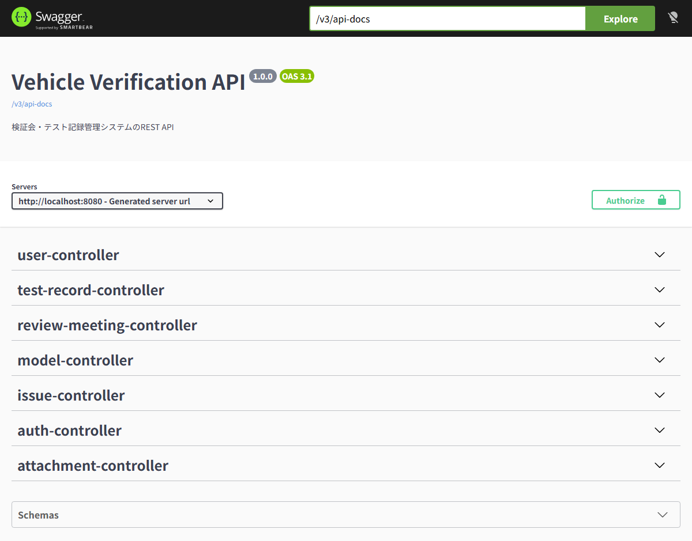

# vehicle-verification-api

車両の検証会（レビュー会）を管理するための REST API です。
機種・検証会・試験記録・指摘事項・添付ファイルを一元管理し、検証会ごとの試験結果／指摘事項の集計を返します。

> 🚧 **ステータス**: AWS（EC2 + systemd / RDS / S3）上で稼働中です。HTTPS 化（ALB + ACM）が完了するまでは、アクセス元を制限しています。

関連リポジトリ: [python-batch](https://github.com/fukukazudev-git/python-batch)（検証会の一括インポート／エクスポートを行うバッチ。本 API を利用）

---

## 主な機能

| 機能 | 概要 |
| --- | --- |
| 認証 | JWT によるステートレス認証（`/api/auth/login`）、ログイン試行回数の制限 |
| ユーザー管理 | ロール（管理者／メンバー）による権限制御、パスワード変更・再設定 |
| 機種管理 | 検証対象の機種（モデル）の CRUD、バージョン検索 |
| 検証会管理 | 検証会の CRUD、ステータス管理（検証前／検証中／完了／中断） |
| 試験記録 | 検証会に紐づく試験記録の CRUD、結果（OK／NG／保留） |
| 指摘事項 | 指摘の CRUD、ステータス遷移のバリデーション（未対応→対応中→承認待ち→完了） |
| 添付ファイル | アップロード／ダウンロード。ローカル保存と S3 保存をプロファイルで切替 |
| 集計 | 検証会ごとの試験結果サマリ・指摘事項サマリ |
| API ドキュメント | springdoc-openapi による Swagger UI |

## 技術スタック

- **言語 / FW**: Java 21, Spring Boot 4.1
- **永続化**: Spring Data JPA, MySQL 8.0
- **認証**: Spring Security, JWT (jjwt)
- **ストレージ**: ローカルファイル / Amazon S3 (AWS SDK v2)
- **API ドキュメント**: springdoc-openapi (Swagger UI)
- **ビルド**: Gradle
- **コード整形**: Spotless (palantir-java-format)
- **テスト**: JUnit 5, Spring Boot Test, Spring Security Test
- **実行環境**: Docker / Docker Compose

## アーキテクチャ

レイヤードアーキテクチャを採用し、依存方向を `presentation → application → domain` の内向きに揃えています。

```
com.example.vehicleverification
├── domain/            … Entity・Repository・ドメイン例外（ロジックを持たない）
├── application/       … Service（インターフェース + Impl）、層をまたぐ DTO
├── presentation/      … Controller、@ControllerAdvice による例外の一元処理、エラー DTO
└── infrastructure/    … Spring Security・JWT・設定クラス
```

設計上のポイント:

- 入力チェックは Bean Validation（`@Valid`）で行い、Controller に検証コードを書かない
- 開発用デフォルトの JWT シークレット・管理者パスワードのまま起動した場合は警告ログを出力

### 設計判断

- **ログイン試行制限はユーザー名単位・メモリ管理**

  ALB 配下では接続元 IP が ALB になり、`X-Forwarded-For` の扱いを誤るとヘッダー偽装で回避されたり、全員が同じ IP として数えられたりする。そのためアプリではユーザー名単位で、5 回連続失敗すると 15 分ロック（429 + `Retry-After`）とした。
  存在しないユーザー名も同様に数え、ユーザーの有無を外部から判別できないようにしている。単一インスタンスのため DB ではなくメモリで管理し、IP 単位の制限は AWS WAF で補う方針。

- **参照されているデータの削除は 409 を返す**

  事前チェックに加え、同時実行ですり抜けた場合も DB 制約違反を 409 に変換して二重に守る。

- **ストレージをインターフェースで抽象化**

  ローカル開発では外部サービスなしで動かし、本番だけ S3 に切り替えるため。

- **トランザクションスクリプトの設計スタイル**

  機能の大半が CRUD と集計のため、Service にビジネスロジックを集約し、Entity は DB とのマッピングに専念させた。ルールが増えた部分（指摘事項のステータスごとの必須項目チェックなど）は、ドメインモデルへ寄せる余地がある。

- **エラーレスポンスの統一**

  `@RestControllerAdvice` で例外処理を一元化し、どの API のエラーも同じ形式（`ErrorResponse`）で返す。クライアントが 1 通りの処理でエラーを扱えるようにするため。例外メッセージや内部の型名はクライアントに返さず、ログにのみ出力する。

詳細なコーディング規約は [CLAUDE.md](CLAUDE.md) を参照してください。

## ER 概要

```
models ──< review_meetings ──< test_records
                 │   │               │
                 │   └──< issues     │
                 │                   │
                 └──< attachments >──┘

users … 検証会の主催者、試験記録の記録者、指摘の起票者／回答者、添付のアップロード者として各テーブルから参照
```

テーブル定義は [sql/init.sql](sql/init.sql) を参照してください。

## ローカルでの起動

### 前提

- Docker / Docker Compose

### 手順

```bash
cp .env.example .env        # 必要に応じて値を変更
docker compose up --build
```

起動後、以下にアクセスできます。

- API: http://localhost:8080
- Swagger UI: http://localhost:8080/swagger-ui.html
- MySQL: `localhost:3307`

初回起動時に管理者ユーザーが自動作成されます（`ADMIN_USERNAME` / `ADMIN_PASSWORD`、未指定時は開発用デフォルト値）。

> `sql/init.sql` はボリューム初回作成時のみ実行されます。テーブル定義を変更した場合は `docker compose down -v` でボリュームを作り直してください。

### 動作確認

[docs/http/smoke-test.http](docs/http/smoke-test.http) に、ログインから各 API を一通り呼び出すリクエストをまとめています（VS Code REST Client 等で実行）。

## 環境変数

| 変数 | 説明 | デフォルト |
| --- | --- | --- |
| `SPRING_PROFILES_ACTIVE` | `local`（ローカル保存）/ `prod`（S3 保存） | `local` |
| `SPRING_DATASOURCE_URL` | DB 接続 URL | `jdbc:mysql://localhost:3307/verification_db` |
| `SPRING_DATASOURCE_USERNAME` / `SPRING_DATASOURCE_PASSWORD` | DB 認証情報 | 開発用値 |
| `JWT_SECRET` | JWT 署名キー（32 文字以上） | 開発用値（**本番では必ず変更**） |
| `ADMIN_USERNAME` / `ADMIN_PASSWORD` | 初期管理者 | 開発用値（**本番では必ず変更**） |
| `LOCAL_STORAGE_PATH` | ローカル保存先（`local` プロファイル） | `./uploads` |
| `S3_BUCKET_NAME` / `S3_REGION` | S3 保存先（`prod` プロファイル） | `vehicle-verification-attachments` / `ap-northeast-1` |

## API 一覧

`/api/auth/**` と Swagger UI 以外は JWT（`Authorization: Bearer <token>`）が必要です。

| リソース | エンドポイント |
| --- | --- |
| 認証 | `POST /api/auth/login` |
| ユーザー | `GET/POST /api/users`, `GET/PUT/DELETE /api/users/{id}`, `PUT /api/users/me/password`, `PUT /api/users/{id}/password`, `GET /api/users/roles` |
| 機種 | `GET/POST /api/models`, `GET/PUT/DELETE /api/models/{id}` |
| 検証会 | `GET/POST /api/review-meetings`, `GET/PUT/DELETE /api/review-meetings/{id}`, `GET /api/review-meetings/statuses` |
| 集計 | `GET /api/review-meetings/{id}/test-summary`, `GET /api/review-meetings/{id}/issue-summary` |
| 試験記録 | `GET/POST /api/test-records`, `GET/PUT/DELETE /api/test-records/{id}`, `GET /api/test-records/results` |
| 指摘事項 | `GET/POST /api/issues`, `GET/PATCH/DELETE /api/issues/{id}`, `GET /api/issues/statuses` |
| 添付ファイル | `POST /api/attachments`, `GET /api/attachments/{id}/download`, `DELETE /api/attachments/{id}` |

ユーザーの登録・更新・削除、他ユーザーのパスワード再設定は管理者（`ADMIN`）のみ実行できます。
リクエスト／レスポンスの詳細は Swagger UI を参照してください。



## 開発

```bash
./gradlew build          # ビルド + テスト + spotlessCheck
./gradlew test           # テストのみ
./gradlew spotlessApply  # コード整形
```

クローン後に一度だけ pre-commit フック（コミット時の自動整形）を有効化してください。

```bash
git config core.hooksPath .githooks
```

## デプロイ（AWS）

> 🚧 EC2 + systemd で常駐し、RDS・S3 と連携して稼働中。HTTPS 化（ALB + ACM）は対応予定。

- アプリケーション: EC2（Amazon Linux 2023）上で jar を systemd で常駐（自動起動・異常終了時の自動再起動）。手順は [deploy/README.md](deploy/README.md)
- 添付ファイル: Amazon S3（`prod` プロファイル、EC2 の IAM ロールで接続）
- データベース: Amazon RDS for MySQL

## 今後の予定

- [x] AWS へのデプロイ（EC2 + RDS + S3）
- [ ] ALB + ACM + Route 53 による HTTPS 化（独自ドメイン・証明書の自動更新）
- [ ] CloudFormation によるインフラのテンプレート化（IaC）
- [ ] CI（GitHub Actions）によるビルド・テストの自動化
